

<a href="https://akshatparashar.vercel.app/"></a>

<a href="#career">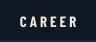</a><a href="#agents">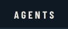</a><a href="#collection">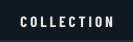</a><a href="#stats">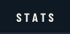</a><a href="#night-market">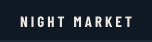</a>

 


  


  

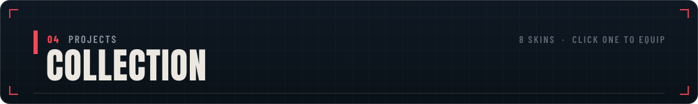

<a href="https://resume-bolt.vercel.app/">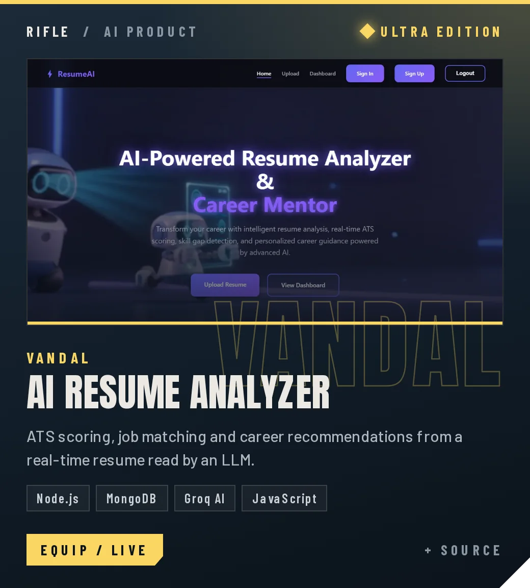</a>
<a href="https://dsa-teacher.vercel.app/">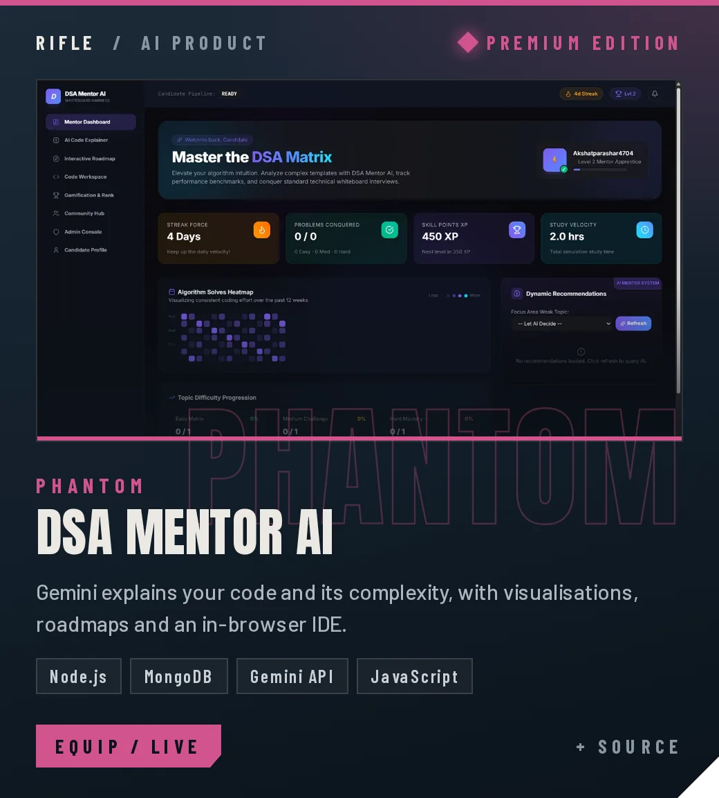</a>
<a href="https://www.vishvora.com/">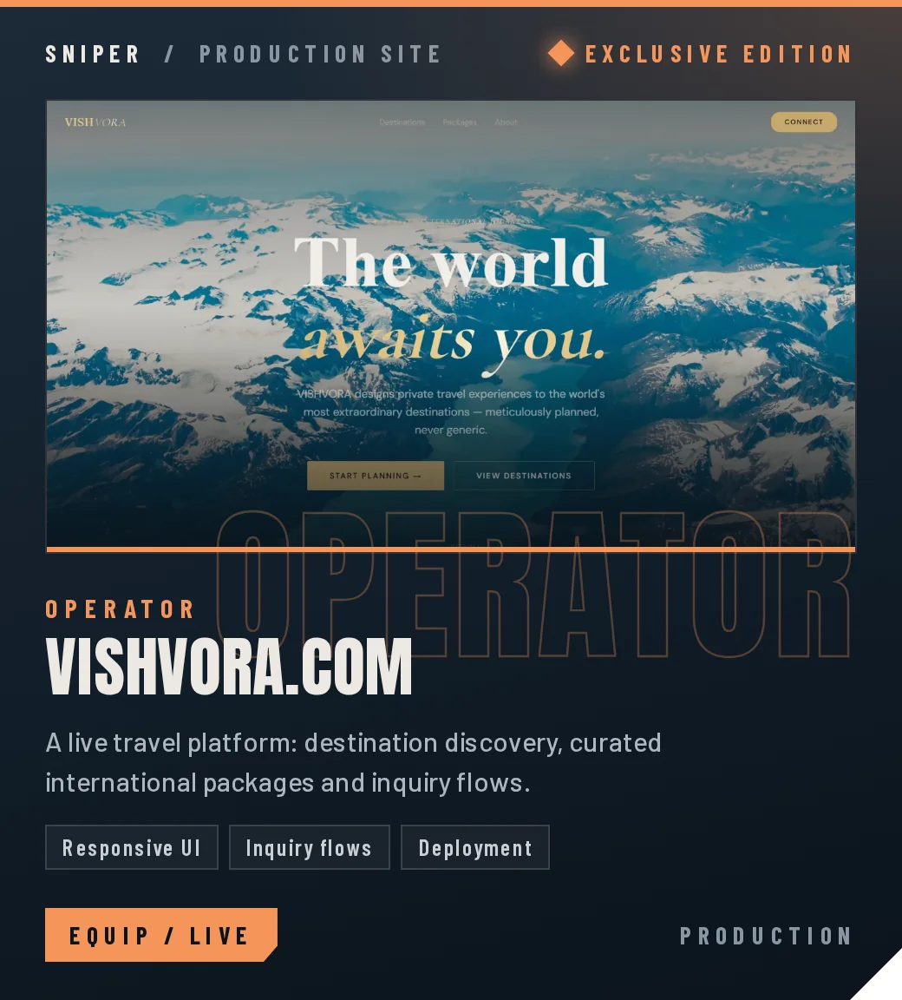</a>
<a href="https://tunesofdunes.com/">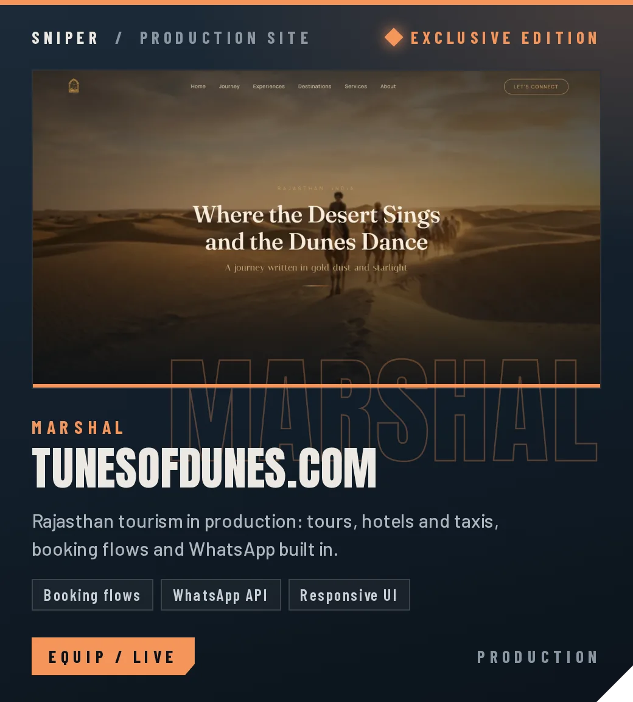</a>
<a href="https://github.com/akshatparashar/A54-PocketLab">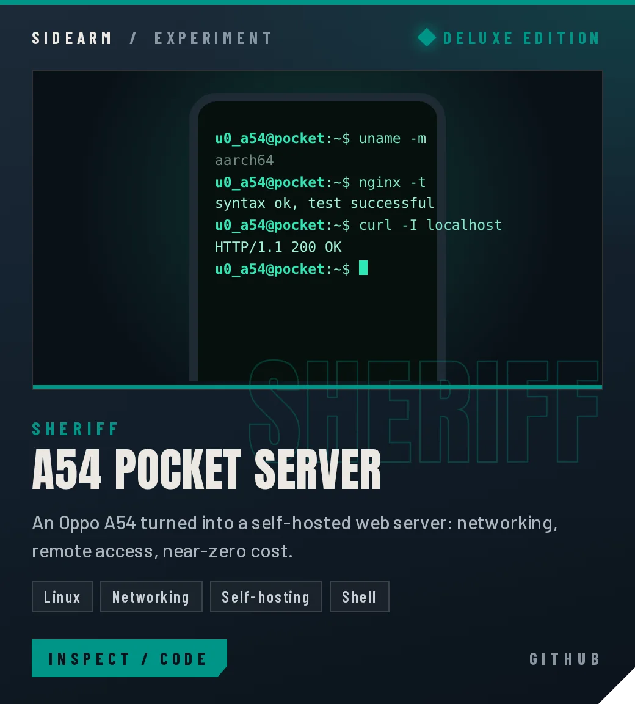</a>
<a href="https://github.com/akshatparashar/HAND_GESTURE">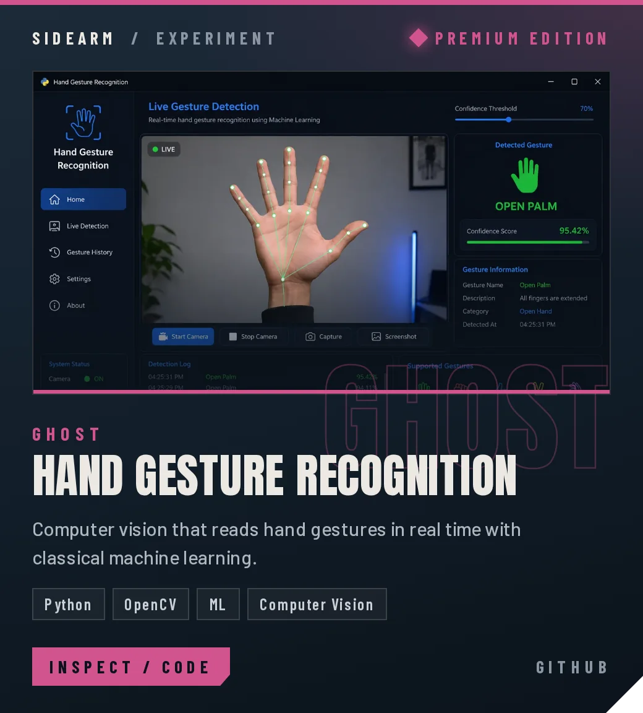</a>
<a href="https://animated-website-dun.vercel.app/">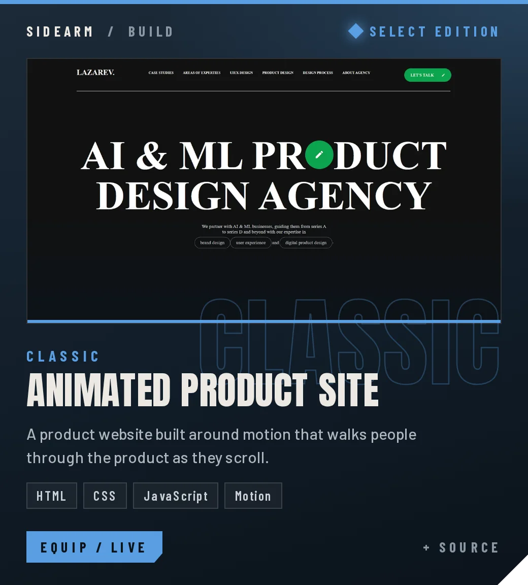</a>
<a href="https://akshatparashar.vercel.app/">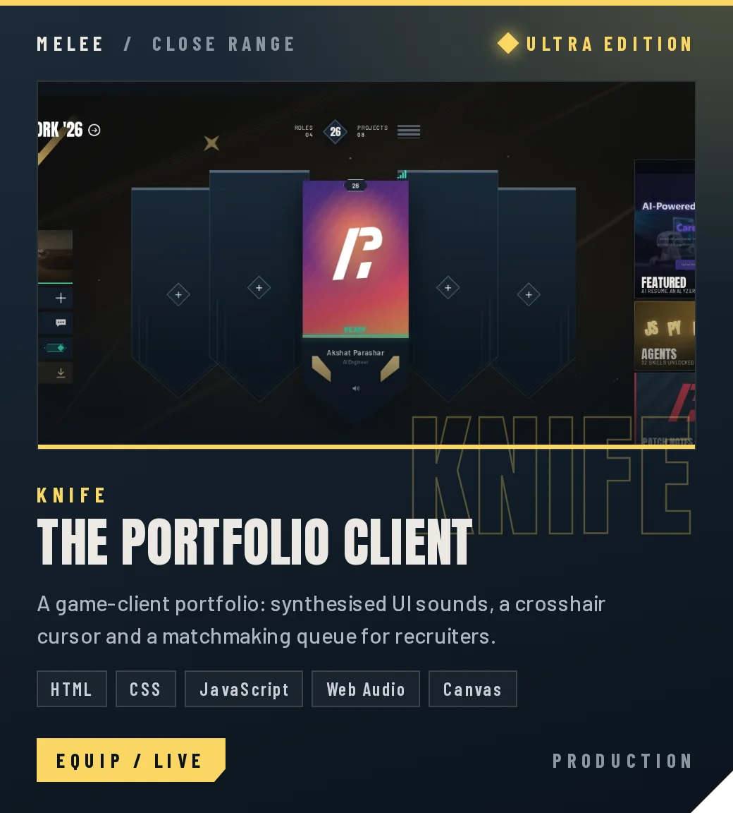</a>

SOURCE &nbsp;·&nbsp; <a href="https://github.com/akshatparashar/resume-frontend">AI Resume Analyzer</a> &nbsp;·&nbsp; <a href="https://github.com/akshatparashar/DSA_TEACHER">DSA Mentor AI</a> &nbsp;·&nbsp; <a href="https://github.com/akshatparashar/animated_website">Animated Product Site</a> &nbsp;·&nbsp; <a href="https://github.com/akshatparashar/PROTFOLIO">Portfolio Client</a>

  


  


  

<a href="mailto:akshatparashar4704@gmail.com"></a>

&nbsp;
&nbsp;
&nbsp;
&nbsp;

  

